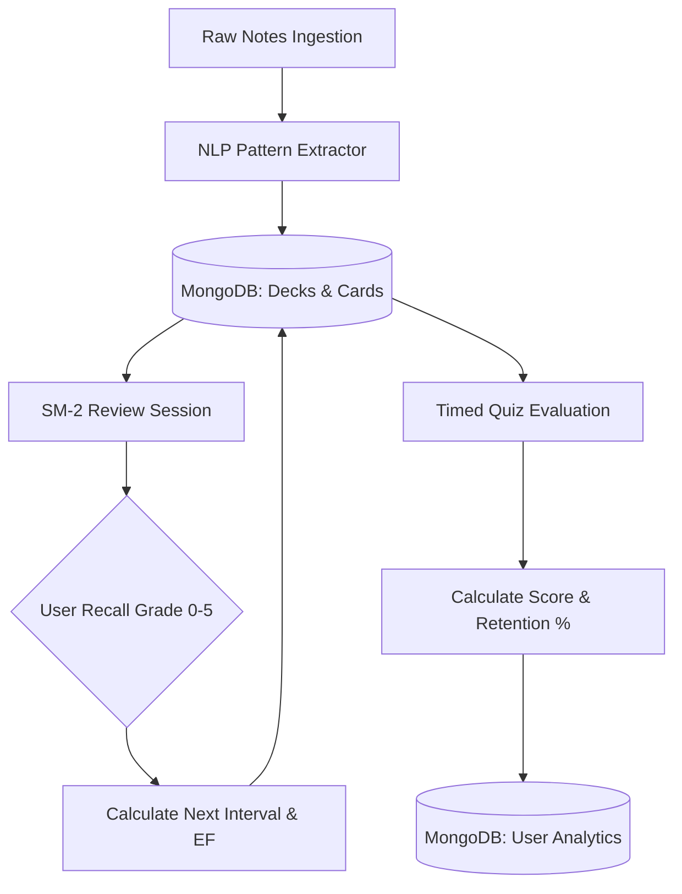

# ⚡ RecallPulse — Intelligent Spaced Repetition & Study Extraction Engine

> **A fullstack active-recall learning application that ingests unstructured lecture notes, extracts conceptual flashcards & quizzes, and schedules reviews using the SuperMemo SM-2 Spaced Repetition Algorithm.**

---

## 📋 Project Information

- **Project Name:** RecallPulse
- **Student Name:** Samar Bhardwaj
- **Domain:** EdTech / Cognitive Science / Developer Productivity
- **Application Type:** Full-Stack Web Application (MERN)

---

## 🎯 1. Problem Statement

Students, engineers, and researchers encounter massive quantities of lecture notes, documentation, and technical material. However, **passive reading leads to rapid forgetting** (the Ebbinghaus Forgetting Curve shows up to 80% memory decay within 48 hours without active recall).

Manually formulating flashcards and quizzes is time-consuming, while generic AI wrappers simply dump raw LLM text with no persistent memory mechanics. 

**RecallPulse solves this by providing:**
1. **Automated Material Extraction**: Parses raw notes into high-yield definition cards and multiple-choice quizzes.
2. **Algorithmic Recall Scheduling**: Dynamically schedules card intervals using the **SuperMemo SM-2 mathematical model**.
3. **Timed Quiz Reinforcement**: Validates comprehension under exam conditions with instant feedback.
4. **Mastery Analytics**: Quantifies retention rates, study streaks, and ease factors over time.

---

## 👥 2. Target Users

- **Computer Science & Engineering Students** preparing for technical vivas, semester exams, and coding interviews.
- **Self-Taught Developers** digesting complex architectural docs (APIs, concurrency, cloud patterns).
- **Instructors & Tutors** looking to instantly convert lecture summaries into interactive student review decks.

---

## 🛠️ 3. Tech Stack & Engineering Decisions

| Layer | Technology | Engineering Rationale |
|---|---|---|
| **Frontend** | React 19 + Vite | Fast HMR, reactive state management, interactive 3D flip-card animations |
| **Routing** | React Router v7 | Protected client-side routing, modular workflow navigation |
| **Backend** | Node.js + Express | Lightweight event-driven REST API, decoupled modular controllers |
| **Database** | MongoDB Atlas + Mongoose | Flexible embedded document schemas for flashcard review history & quiz attempts |
| **Authentication** | JWT + HttpOnly Cookies | Secure token-based session verification with XSS mitigation |
| **Algorithm** | SuperMemo SM-2 | Rigorous mathematical formula calculating optimal intervals and Ease Factors (EF) |

---

## 🧠 4. Core Application Logic & Architecture



### The SuperMemo SM-2 Spaced Repetition Formula
Every time a user reviews a card, they submit a recall grade $q \in [0, 5]$.
The backend calculates:

$$\text{EF}' = \text{EF} + \left(0.1 - (5 - q) \times (0.08 + (5 - q) \times 0.02)\right)$$
$$\text{Where } \text{EF}' \ge 1.3$$

* If $q < 3$ (Failed recall): $\text{Repetition} = 0, \text{Interval} = 1 \text{ day}$.
* If $q \ge 3$ (Successful recall):
  * First repetition: $\text{Interval} = 1 \text{ day}$
  * Second repetition: $\text{Interval} = 6 \text{ days}$
  * Subsequent: $\text{Interval}_n = \text{Interval}_{n-1} \times \text{EF}$

---

## 🚀 5. Major Workflows Implemented

1. **User Authentication & Session Security**: Secure registration, password hashing (`bcryptjs`), and JWT verification.
2. **Deterministic Note Parsing**: Line-by-line extractor parsing definition patterns (`Term: Definition`) and relationship predicates (`is a`, `refers to`).
3. **Interactive 3D Flashcard Review**: Card flip interaction with 6-tier SM-2 quality buttons ($0$ Blackout to $5$ Perfect).
4. **Timed Multiple-Choice Exam**: 4-option quiz with randomized distractors, timer, score percentage, and detailed explanations.
5. **Mastery Analytics Dashboard**: Aggregates retention rate, cards due today, study streak, and past quiz attempts.

---

## 💻 6. Local Setup Instructions

### Prerequisites
- Node.js (v18+)
- MongoDB Atlas or local MongoDB instance

### 1. Clone the Repository
```bash
git clone https://github.com/YOUR_USERNAME/RecallPulse.git
cd RecallPulse
```

### 2. Backend Setup
```bash
cd backend
npm install
cp .env.example .env
# Edit .env with your MongoDB Atlas URI & JWT Secret
npm start
```

### 3. Frontend Setup
```bash
cd ../frontend
npm install
npm run dev
```

Open `http://localhost:5173` in your browser.

---

## 🔒 7. Environment Variables (`backend/.env.example`)

```env
PORT=5000
MONGODB_URI=your_mongodb_connection_string
JWT_SECRET=your_jwt_secret_key
CLIENT_URL=http://localhost:5173
```
